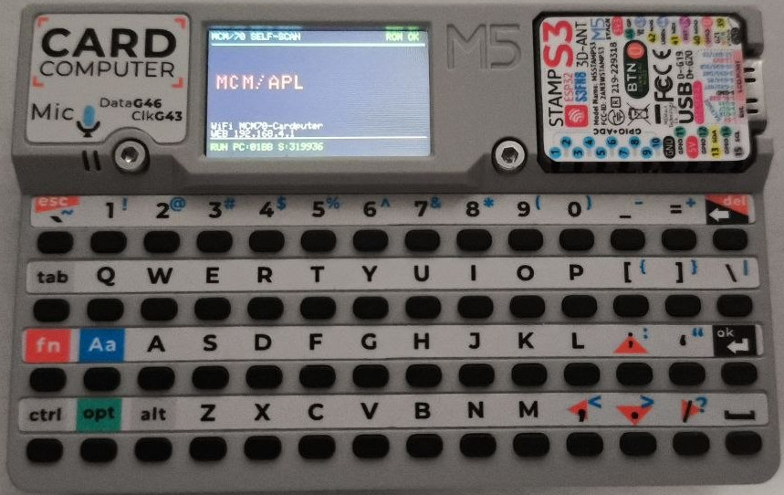

# M5Cardputer MCM/70 Emulator

**[English Version](#english-version) | [Versión en Español](#versión-en-español)**

---

## English Version

More information at [Minibots](https://minibots.wordpress.com/2026/10/16/emulador-de-mcm-70-con-m5stack-cardputer/).

This project is a complete emulator of the MCM/70 microcomputer, specifically adapted to run on the M5Stack Cardputer platform. It is based on the MCM/70E emulator, whose Linux source code was kindly shared by its creator, Zbigniew Stachniak. The core has been reused as much as possible, decoupling it from graphical interface dependencies and adapting peripherals, storage, and user interaction for an embedded environment. 

The result is a standalone version that allows you to run the emulated environment, use the physical keyboard, view the MCM/70 screen on the TFT, manage tapes from a web browser, and check the emulated printer output.

### Architectural Changes

- **Desktop GUI Removal:** The original MCM/70E uses a desktop graphical interface and OpenGL/GLUT components where CPU execution and screen updates are tied to the event loop. In this emulator:
  - Functional dependency on the desktop graphical window has been completely removed.
  - The GLUT event-dependent execution model has been replaced by a firmware loop suitable for the embedded environment.
  - Emulator logic is fully separated from physical display and input mechanisms.
  - Incompatible I/O operations for the target platform have been replaced.

### System Architecture

The firmware is organized into components with distinct responsibilities:

- **MCM Core:** Emulation logic and machine state.
- **Display:** Adaptation of the logical representation to the TFT screen.
- **Keyboard:** Acquisition and translation of the M5Cardputer's physical keys.
- **Tape Storage:** Access to tape images stored in the `LittleFS` filesystem.
- **Network:** HTTP server and management of tape operations from a web browser.
- **Printer:** Capturing and querying the output of the emulated MCP-132 device.
- **Debugging:** Diagnostic messages via USB-C/Serial.

### Quick Start Guide

- **Installation:** Compile and upload the firmware to the M5Cardputer using your IDE. You must write the filesystem (`LittleFS`) to host the required web and tape files.
- **Web Connection:** Connect your M5Cardputer to your WiFi network and access the IP shown on the serial monitor from any web browser to manage tapes and printer outputs.
- **Basic Operation:** Use the physical keyboard to interact with the APL environment directly on the device.

### Requirements

- **Hardware:** M5Stack Cardputer device.
- **Software/Libraries:** PlatformIO or Arduino IDE, `LittleFS` upload tools, and required web/network libraries.

### License

This project is licensed under the **GNU General Public License v2.0**. See the `LICENSE` file for more details. 

*Note: The original MCM/70E source code is Copyright (c) 2019 Zbigniew Stachniak.*

### Retrocomputing

See this system on the [timeline](https://sites.google.com/view/minibotsmuseum/timeline) of our [Retrocomputing Museum](https://sites.google.com/view/minibotsmuseum).

---

## Versión en Español

Más información en [Minibots](https://minibots.wordpress.com/2026/10/16/emulador-de-mcm-70-con-m5stack-cardputer/).

Este proyecto es un emulador del microordenador MCM/70, adaptado específicamente para ejecutarse en la plataforma M5Stack Cardputer. Utilizaremos como base el emulador MCM/70E, cuyo código fuente para Linux nos compartió amablemente su creador Zbigniew Stachniak.

Se ha reutilizado el núcleo existente en la medida en que ha sido posible, separándolo de las dependencias de la interfaz gráfica y adaptando los periféricos, el almacenamiento y la interacción con el usuario. El resultado es una versión embebida que permite ejecutar el entorno emulado, utilizar el teclado físico del Cardputer, visualizar la pantalla del MCM/70 en el TFT, gestionar cintas desde un navegador y consultar la salida de la impresora emulada.

### Cambios en la Arquitectura

**Eliminación de la interfaz gráfica de escritorio:**
MCM/70E utiliza una interfaz gráfica de escritorio y componentes asociados a OpenGL/GLUT donde parte de la ejecución de la CPU y de las actualizaciones de pantalla está vinculada al bucle de eventos de esa interfaz. En nuestro emulador:

- Se elimina la dependencia funcional de la ventana gráfica de escritorio.
- Se sustituye el modelo de ejecución dependiente de eventos de GLUT por un bucle de firmware adecuado al entorno embebido.
- Se separa la lógica del emulador de los mecanismos físicos de visualización y entrada.
- Se sustituyen las operaciones de entrada/salida incompatibles con la plataforma de destino.

### Arquitectura del Sistema

**Adaptación al entorno embebido:**
El firmware se organiza en componentes con responsabilidades diferenciadas:

- **Núcleo MCM:** Lógica de emulación y estado de la máquina.
- **Pantalla:** Adaptación de la representación lógica a la TFT.
- **Teclado:** Adquisición y traducción de las teclas físicas.
- **Almacenamiento de cintas:** Acceso a las imágenes de cinta en `LittleFS`.
- **Red:** Servidor HTTP y gestión de operaciones desde el navegador.
- **Impresora:** Captura y consulta de la salida del dispositivo MCP-132.
- **Depuración:** Mensajes de diagnóstico mediante USB-C/Serial.

### Guía Rápida de Uso

- **Instalación:** Compila y sube el firmware al M5Cardputer usando tu entorno de desarrollo. Es obligatorio escribir el sistema de archivos (`LittleFS`) para alojar los archivos necesarios de la web y las cintas.
- **Conexión Web:** Conecta tu M5Cardputer a la red WiFi y entra a la IP mostrada por el puerto serie desde cualquier navegador para gestionar las cintas y la impresora.
- **Operación Básica:** Utiliza el teclado físico del dispositivo para interactuar directamente con el entorno APL del MCM/70.

### Requisitos

- **Hardware:** Dispositivo M5Stack Cardputer.
- **Entorno de desarrollo:** PlatformIO (recomendado) o Arduino IDE.
- **Herramientas:** Subida de sistema de archivos `LittleFS` configurada en tu IDE.

### Licencia

Este proyecto está licenciado bajo la **GNU General Public License v2.0**. Puedes consultar el archivo `LICENSE` para más detalles. 

*Nota: El código fuente original del MCM/70E tiene licencia de Copyright (c) 2019 Zbigniew Stachniak.*

Retroinformática

Véase este sistema en la [línea temporal](https://sites.google.com/view/minibotsmuseum/timeline) de nuestro [Museo de la Retroinformática](https://sites.google.com/view/minibotsmuseum).